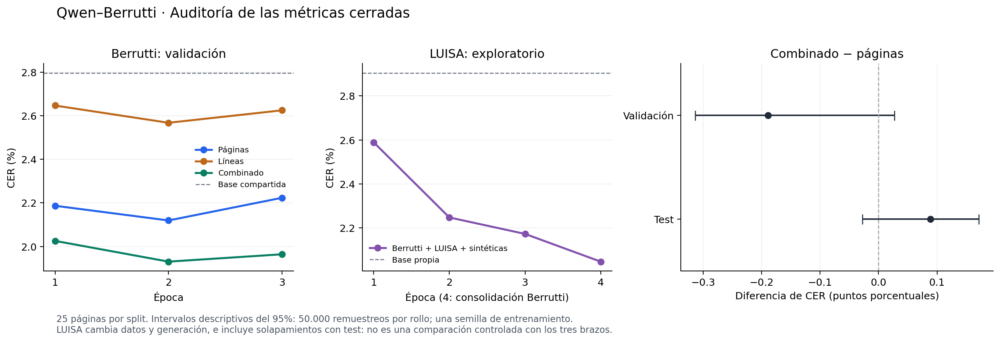

# Auditoría del fine-tuning Qwen–Berrutti · 22 de octubre de 2026

Estado: auditoría independiente completada y verificada el 22 de octubre de 2026. Los cuatro entrenamientos están cerrados; el test de líneas conserva su página incompleta y su carácter provisional.

El combinado Berrutti obtiene el mejor CER de validación de la comparación controlada. Sólo páginas es la alternativa de menor coste observado: los CER de test son cercanos en este conjunto y el coste registrado es menor. Sólo líneas presenta problemas de robustez al transcribir páginas completas. La extensión LUISA mejora respecto a su propia baseline, pero esta prueba no demuestra una ventaja independiente de añadir LUISA.

## Resultados que se conservan

Todos los CER/WER usan `ascii-text-v1`: transliteración AnyASCII y normalización de espacios, sin cambiar referencias ni OCR. Las cifras son microagregados de errores y caracteres/palabras. Validación y test contienen 25 páginas cada uno. El test describe el checkpoint elegido por validación; no lo selecciona.

| Modelo | Época elegida | CER validación | WER validación | CER test | WER test | Test completo | Fallidas / reintentadas |
| --- | ---: | ---: | ---: | ---: | ---: | ---: | ---: |
| Base compartida, sin ajuste | 0 | 2,796 % | 10,394 % | 5,393 % | 18,533 % | 25/25 | 0 / 1 |
| Sólo páginas | 2 | 2,119 % | 7,195 % | 3,141 % | 7,144 % | 25/25 | 0 / 3 |
| Sólo líneas | 2 | 2,567 % | 8,898 % | 19,846 % provisional | 21,441 % provisional | 24/25 | 1 / 2 |
| Combinado Berrutti | 2 | 1,930 % | 6,565 % | 3,230 % | 7,722 % | 25/25 | 0 / 4 |
| Base propia de la extensión, sin ajuste | 0 | 2,904 % | 10,955 % | 5,538 % | 15,869 % | 25/25 | 0 / 3 |
| Berrutti + LUISA + sintéticas, exploratorio | 4 | 2,048 % | 7,490 % | 3,220 % | 7,885 % | 25/25 | 0 / 3 |

Los tres brazos originales parten de los mismos pesos y semilla, recorren las 125 páginas o sus 5.212 recortes durante tres épocas y confirman 48 actualizaciones cada uno. Su política de generación es la misma. Se mantienen las discrepancias entre referencias de página y líneas en 34 páginas de entrenamiento; por ello, las diferencias no se atribuyen únicamente a la representación visual. El combinado reduce el CER de validación un 30,96 % relativo a la base común; páginas, un 24,20 %. En test las reducciones descriptivas son 40,11 % y 41,75 %, respectivamente.

La extensión confirma 64 actualizaciones: tres épocas con todas las 23.774 líneas LUISA, las 125 páginas/5.212 líneas Berrutti y 1.991 composiciones en total, más una cuarta época sólo Berrutti. Se presentan 94.661 imágenes en total. Su validación final baja de 2,904 % a 2,048 % respecto a su propia baseline (29,50 % relativo). El test pasa de 5,538 % a 3,220 % (41,85 % relativo).

## Evolución por época

Cada cifra corresponde a las mismas 25 páginas completas de validación. Las trece validaciones finales de época terminaron sin páginas fallidas ni reintentadas.

| CER de validación | Época 1 | Época 2 | Época 3 | Época 4 |
| --- | ---: | ---: | ---: | ---: |
| Sólo páginas | 2,187 % | **2,119 %** | 2,223 % | — |
| Sólo líneas | 2,647 % | **2,567 %** | 2,625 % | — |
| Combinado Berrutti | 2,026 % | **1,930 %** | 1,964 % | — |
| Extensión LUISA, exploratoria | 2,589 % | 2,248 % | 2,173 % | **2,048 %** |

Los doce controles intermedios de la extensión se conservan para describir el avance; no participan en la selección. Todos completaron las 25 páginas, sin fallidas ni reintentadas.

| Época de la extensión | CER tras update 4 de la época | Tras update 8 | Tras update 12 |
| --- | ---: | ---: | ---: |
| 1 | 2,992 % | 2,745 % | 2,603 % |
| 2 | 2,607 % | 2,365 % | 2,251 % |
| 3 | 2,178 % | 2,245 % | 2,052 % |
| 4, consolidación | 2,130 % | 2,131 % | 2,119 % |

El test se evaluó una sola vez por modelo, después del entrenamiento, usando el checkpoint elegido.

[Figura SVG](figures/finetuning_audit_20261022.svg)

## Qué diferencia está respaldada

Se comparan los errores de las mismas páginas, conservando sus denominadores. Se hicieron 50.000 remuestreos pareados con semilla estadística 20261022, por página y, como análisis de sensibilidad, por rollo. Hay nueve rollos de validación y ocho de test. El rollo es una agrupación disponible, no una certificación de documento independiente. El procedimiento de remuestreo pareado se describe en la [documentación de SciPy](https://docs.scipy.org/doc/scipy/reference/generated/scipy.stats.bootstrap.html); aquí se implementa sin depender de SciPy.

| Diferencia de CER, en puntos porcentuales | Observada | Intervalo descriptivo 95 %, por rollo |
| --- | ---: | ---: |
| Combinado − páginas, validación | −0,189 | [−0,313; +0,027] |
| Combinado − páginas, test | +0,088 | [−0,028; +0,172] |
| Líneas − páginas, validación | +0,448 | [+0,228; +0,922] |
| Páginas − base compartida, test | −2,252 | [−4,266; −0,396] |
| Combinado − base compartida, test | −2,163 | [−4,116; −0,406] |

El combinado aventaja a páginas en validación por 129 errores de carácter. En test páginas tiene 66 errores menos que el combinado. Los intervalos agrupados incluyen cero en ambas comparaciones entre estos dos modelos: esta corrida no establece una superioridad general de uno sobre otro. El intervalo por página de validación roza cero por debajo; agrupar por rollo elimina esa aparente certeza. Páginas y combinado sí mejoran de manera consistente respecto a su baseline en estas evaluaciones.

Estos intervalos son descriptivos y condicionales a los checkpoints ya seleccionados y a una sola semilla de entrenamiento. No corrigen el proceso de selección, múltiples comparaciones ni variabilidad entre entrenamientos. El test continúa siendo descriptivo.

## Robustez del modelo de líneas

La página incompleta conserva sus dos intentos agotados por repetición. Además hay una página que llegó a EOS, consumió un intento y obtuvo CER superior al 100 %. Terminar la generación no garantiza una transcripción correcta. Estos dos casos pertenecen al mismo rollo y concentran 13.043 de los 14.816 errores de carácter de líneas (88,03 %).

Como diagnóstico, en las mismas 24 páginas completas para los tres brazos y la baseline, el CER es 2,737 % para páginas, 2,867 % para combinado y 13,184 % para líneas. Esta sensibilidad conserva también el caso erróneo que llegó a EOS. No sustituye el test original de 25 páginas ni vuelve completo el resultado de líneas. En validación completa líneas también pierde frente a páginas; su desventaja no depende sólo de la página incompleta. El resultado corresponde a entrenamiento en recortes seguido de inferencia sobre páginas completas; no evalúa un pipeline de segmentación y OCR por línea.

Se verifican todos los intentos y sus reservas, con máximo dos por página, parámetros conservados y primera generación exitosa seleccionada sin consultar la referencia. Se conserva el resultado provisional de líneas. Reintentar únicamente las salidas de CER alto para mejorar el número introduciría selección por la respuesta humana; no forma parte del protocolo evaluado.

## Alcance de LUISA y de las pruebas técnicas

`include-all` incorpora el test publicado de LUISA y solapamientos conocidos con el test Berrutti. La independencia documental no está certificada. También cambian el número de épocas, las familias de ejemplos, sus pesos, la precisión de inferencia y la generación: la extensión usa muestreo instruct con semillas por imagen/intento y otra baseline. Los tres brazos Berrutti usan generación determinista. Las cifras de LUISA describen una extensión completa, no el efecto aislado de añadir líneas o composiciones sintéticas.

La caché visual experimental se rechazó al no superar la identidad de gradientes y quedó fuera de la comparación final. Los ensayos de precisión previos no bastaron para resolver la repetición de aquel probe. La candidata final pasó el ensayo íntegro con el muestreo instruct autorizado; esto acredita esa receta, sin localizar la causa de la repetición anterior ni aislar el efecto del muestreo.

La cuarta época tiene mejor validación que la tercera, pero no hay una ablación que permita atribuir la mejora únicamente a la consolidación. Los controles de memoria, precisión, kernels y cachés acreditan los contratos que comprobaron; no son otros modelos, épocas ni pruebas aisladas de mejora de OCR. Los experimentos retirados y borrados permanecen fuera de esta comparación.

## Coste observado y decisión

| Modelo | Horas del entrenamiento confirmado | GPU·h equivalentes, dos A100 |
| --- | ---: | ---: |
| Sólo páginas | 6,46 | 12,93 |
| Sólo líneas | 18,79 | 37,58 |
| Combinado Berrutti | 25,23 | 50,46 |
| Berrutti + LUISA + sintéticas | 137,45 | 274,90 |

Estas cifras suman los tiempos de los bloques confirmados de entrenamiento y los multiplican por las dos GPU asignadas. Incluyen el trabajo CPU/E/S dentro de esos bloques; no miden utilización efectiva de kernels y excluyen arranques, evaluaciones y trabajo fallido. No son una predicción de rendimiento futuro.

- **Selección por el criterio experimental fijado:** combinado Berrutti, checkpoint de la época 2, por menor CER de validación completa.
- **Alternativa para priorizar coste:** sólo páginas, checkpoint de la época 2. Su test es ligeramente menor y la diferencia con combinado no es concluyente.
- **Sólo líneas:** no lo elegiría para reconocimiento de páginas completas bajo esta receta; conserva fallos de robustez y peor validación.
- **LUISA:** el entrenamiento funciona y mejora su baseline, pero no acredita una ventaja independiente que justifique preferirlo a los dos finalistas Berrutti.

Una afirmación de superioridad general requeriría repetir con varias semillas de entrenamiento y evaluar un conjunto nuevo independiente. Para atribuir un efecto a LUISA harían falta exclusiones auditadas y generación/recursos comparables. Ninguna reevaluación de las mismas salidas elimina la contaminación conocida.

## Integridad y trazabilidad

Los dos controles independientes cerraron Slurm COMPLETED y salida cero, con recibos exitosos. El control principal verificó los 208 checkpoints: SHA-256 completos, deserialización CPU, adaptadores y momentos AdamW finitos, cobertura de parámetros, pasos del optimizador, calendario y estados/cursor RNG. Un segundo control confirmó los mismos hiperparámetros de AdamW (betas 0,9/0,999, epsilon 1e-8 y decay cero) y nombres, dimensiones y tipos de adaptador en los 208 estados. Se confirmó la misma inicialización nueva en los cuatro modelos.

Se verificaron las coberturas y las secuencias contiguas de cada modelo (48 + 48 + 48 + 64 actualizaciones), 16 por época; fuentes congeladas, cohortes y splits; baseline previa de cero updates; selección limitada a las validaciones finales y test del checkpoint elegido. La extensión volvió a verificar los bytes y hashes de sus 25.765 imágenes mixtas únicas. Sus diez segmentos nativos de entrenamiento figuran COMPLETED/salida cero.

Se recalcularon 33 evaluaciones únicas de 25 páginas: 350 casos de los tres brazos y baseline común, y 475 de la extensión, baseline propia y controles intermedios; 825 casos únicos en total. El auditor repitió la comprobación de la baseline compartida al verificar cada brazo, por lo que su contador interno registra 925 recalculados. Los resultados coinciden con un segundo recálculo local independiente de los mismos recibos cerrados, incluidos todos los intentos y fallos.

El primer auditor se detuvo por una suposición incorrecta sobre el formato antiguo de cierre de los tres brazos. Se preservó su evidencia, se corrigió sólo el lector, se añadió una regresión y se ejecutó otra copia congelada en una raíz nueva. La verificación del repositorio pasó 264 tests, con tres omisiones existentes, además de compilación, lint y formato. El primer control complementario de metadatos agotó su presupuesto de media hora sin recibo exitoso. Se preservó el fallo y se repitió sólo ese control en otra raíz, usando `FakeTensorMode` para inspeccionar metadatos sin cargar los datos de los tensores, como describe la [documentación de PyTorch](https://docs.pytorch.org/docs/2.11/notes/serialization.html#layout-control), y una comparación contra deserialización nativa. No se alteró ningún entrenamiento, checkpoint, transcripción o referencia.

SHA-256 del manifiesto de evidencia privada: `ca0b16c62df9ae4a00bd8eefa7a3760afc7f112285fb845e63a56c37552d895d`.

La auditoría es CPU y de sólo lectura sobre las corridas: carga y verifica los estados guardados, recalcula métricas a partir de intentos cerrados y conserva los fallos. La restauración GPU del ensayo original se conserva como evidencia previa; esta auditoría no ejecuta una nueva restauración GPU ni repite actualizaciones. La vigilancia y los informes automáticos permanecen desactivados.
